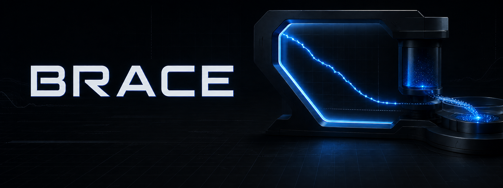

<div align="center">



<br>

[](https://solana.com)
[](https://www.anchor-lang.com)
[](https://nextjs.org)
[](#testing)
[](#current-status)
[](#license)

> Policy-constrained liquidation defense for Kamino: Brace repays debt from a user-funded reserve when on-chain LTV reaches a threshold the user set in advance.

[Devnet program](https://solscan.io/account/CCSVvtVuDpH1wCCQWExCpdmZ1sqUBabJA1QQGai7aVaY?cluster=devnet) · [On-chain design](program/README.md) · [Implementation notes](program/IMPLEMENTATION.md) · [Frontend specification](frontend/PLATFORM.md)

</div>

---

## Problem and solution

### 1. Liquidation risk does not wait for the borrower

**Problem:** a Kamino position can cross its liquidation threshold while its owner is offline. An alert still leaves the owner responsible for noticing it, opening a wallet and submitting a repay in time.

**Brace:** the owner pre-funds a dedicated reserve and defines a policy such as: “at 80% LTV, repay toward 70%; spend no more than 200 USDC per action; act at most twice per hour.” A watcher can submit the action, but the Solana program decides whether it is allowed.

### 2. Automation usually expands trust

**Problem:** giving a bot a transferable key or an unrestricted token approval turns an operational shortcut into a custody risk.

**Brace:** the delegated agent can call only `execute_action`. That instruction has no arbitrary recipient: funds move from the guard vault to the liquidity supply vault recorded by the configured Kamino reserve. Policy changes, deposits, withdrawals and revocation still require the owner.

### 3. A valid decision can become stale before execution

**Problem:** a transaction prepared under one market state may be executed later, after the position has recovered or the oracle data has become stale.

**Brace:** every execution re-reads the Kamino obligation and reserve in the same transaction. It checks account ownership, market relationships, oracle status, refresh slots, LTV, rate limits and post-CPI health before committing state.

## Why Solana

- **Atomic composability:** Brace validates the position and invokes Kamino KLend through CPI in one transaction.
- **Program-enforced permissions:** PDAs, signer constraints and fixed program IDs keep the watcher’s authority narrower than the owner’s authority.
- **Fast state updates:** reserve and obligation refreshes can be placed immediately before the guarded repay.
- **Existing DeFi state:** Brace acts on the borrower’s existing Kamino obligation; it does not require migrating the position into a new lending market.

## What is implemented

### On-chain guard

- Six Anchor instructions: `init_guard`, `deposit_reserve`, `withdraw_reserve`, `update_policy`, `revoke` and `execute_action`.
- Repay-only v1 policy with a trigger LTV, target LTV, per-action cap, cooldown, windowed action limit and expiry.
- Maximum delegation period of 90 days.
- Guard and vault PDAs derived from the owner and Kamino obligation.
- Direct KLend account decoding and `repay_obligation_liquidity_v2` CPI without a Kamino SDK dependency in the program.
- Validation of account owners, discriminators, layout version, market relationships, oracle checks and state freshness.
- Post-CPI invariants that require collateral to remain unchanged and risk-adjusted debt to decrease.
- Owner withdrawals remain available while the guard is paused, expired or revoked.

### Web application

- Public liquidation simulator with recovery, short-wick and no-rebound scenarios.
- Chat-first interface with deterministic commands for position, reserve, authorization, history, pause and revoke flows.
- Browser demo world with explicit failure controls and no wallet required.
- Phantom-based devnet reads and signing, including account-change and reconnect handling.
- Plain JSON-RPC decoding for Kamino positions; `@solana/web3.js` is isolated to transaction and wallet paths.
- User-facing decoding of all Anchor guard errors.

### Devnet tooling

- Scripts that create a real KLend devnet market backed by live Pyth feeds.
- Funding, seed, borrow, refresh and inspection utilities for opening a reproducible test position.
- A reference watcher that refreshes Kamino accounts and submits `execute_action` with the delegated agent key.

## Security model

| Actor | Allowed operations |
|---|---|
| Owner wallet | Create and update a guard, fund or withdraw the reserve, pause and revoke authorization |
| Delegated agent | Call `execute_action` for the configured guard |
| Guard program | Enforce the policy and repay the configured Kamino debt reserve |
| Kamino KLend | Refresh the obligation and process the debt repayment |

The main safety properties are structural:

- The agent cannot select a transfer destination.
- `execute_action` is pinned to the canonical KLend and Farms program IDs.
- The obligation owner, lending market, debt reserve, mint, supply vault and token program must agree.
- The obligation and reserve must be fresh and pass Kamino’s oracle checks.
- The trigger is evaluated at execution time, including for delayed or durable-nonce transactions.
- A repay cannot exceed the vault balance, the owner’s per-action cap or the amount needed to reach the target.
- Failed checks and failed CPIs roll back the entire transaction.

This is defense in depth, not an audit. See [Current status](#current-status) before using the project with funds.

## Architecture

```text
┌─────────────────────┐
│ Owner + Phantom     │
│                     │
│ init / update       │
│ deposit / withdraw  │
│ pause / revoke      │
└──────────┬──────────┘
           │ signs owner operations
           ▼
┌─────────────────────┐       JSON-RPC reads       ┌─────────────────────┐
│ Next.js application │◀──────────────────────────▶│ Kamino obligation   │
│ chat + simulator    │                            │ reserves + markets  │
└─────────────────────┘                            └──────────▲──────────┘
                                                             │
┌─────────────────────┐  refresh + execute_action  ┌─────────┴───────────┐
│ Watcher / agent key │───────────────────────────▶│ Brace guard program │
└─────────────────────┘                            │                     │
                                                   │ policy + live-state │
                                                   │ checks              │
                                                   └─────────┬───────────┘
                                                             │ fixed KLend CPI
                                                             ▼
                                                   ┌─────────────────────┐
                                                   │ Guard vault ───────▶│
                                                   │ KLend supply vault  │
                                                   └─────────────────────┘
```

The watcher proposes execution; it is not a source of authority. If its calculation is wrong, the on-chain checks reject the transaction.

## Repository layout

```text
program/
  programs/guard/          Anchor program and direct Kamino adapter
  tests/litesvm-harness/   Transaction-level and layout regression tests
  tests/mock-klend/        Minimal KLend stand-in loaded at the real program ID
  vectors/                 Shared Rust/TypeScript LTV test vectors

frontend/
  app/                     Landing page, docs, API route and application routes
  components/              Chat, simulator and signed-operation screens
  lib/core/                Framework-free policy, LTV and instruction logic
  lib/platform/            Demo/chain sources, Kamino decoder and wallet boundary

tools/devnet/              KLend market setup, test-position and watcher scripts
```

## Tech stack

| Layer | Technology |
|---|---|
| On-chain program | Rust 1.79 SBF · Anchor 0.31.1 · Solana 2.1.7 |
| Lending integration | Kamino KLend CPI · direct account-layout adapter |
| Frontend | Next.js 16.3.1 · React 19 · TypeScript 5 · Tailwind CSS 4 |
| Data and wallet | JSON-RPC · TanStack Query · `@solana/web3.js` 1.98 |
| Product UI | MDX · Motion · deterministic chat commands · optional LLM fallback |
| Testing | Rust unit tests · proptest · LiteSVM · Node test runner through `tsx` |

## Quick start

### Prerequisites

- Node.js 20+
- Yarn 1.22
- Rust and Cargo
- Solana CLI 2.1.7 with the SBF toolchain

### Run the web app

```bash
git clone https://github.com/Pavlentiyys/brace-solana.git
cd brace-solana/frontend
yarn install --frozen-lockfile
yarn dev
```

Open `http://localhost:3000` for the landing page or `http://localhost:3000/app` for the application. The demo wallet and simulator need no credentials and do not submit transactions.

Brace defaults to Solana devnet. The public RPC works for light testing; configure a dedicated endpoint for repeated polling:

```dotenv
# frontend/.env.local
NEXT_PUBLIC_BRACE_CLUSTER=devnet
NEXT_PUBLIC_BRACE_RPC_URL=https://your-devnet-rpc.example
```

The devnet program ID is compiled into the client and pinned against the Rust source and IDL by tests. Free-form chat outside the deterministic commands optionally uses one of the server-only credentials documented in [`frontend/.env.example`](frontend/.env.example).

### Build and test the program

```bash
cd program

cargo test --workspace
cargo clippy --workspace --all-targets -- -D warnings

cargo build-sbf --manifest-path programs/guard/Cargo.toml
cargo build-sbf --manifest-path tests/mock-klend/Cargo.toml
cargo test --manifest-path tests/litesvm-harness/Cargo.toml
```

Use `cargo build-sbf`, not `anchor build`. The repository pins Anchor dependencies to 0.31.1 and Solana to 2.1.7, while newer globally installed Anchor CLIs may resolve a different toolchain. Dependency-pin details are in [`program/IMPLEMENTATION.md`](program/IMPLEMENTATION.md).

To run the optional CPI test against the real KLend binary:

```bash
solana program dump -u m KLend2g3cP87fffoy8q1mQqGKjrxjC8boSyAYavgmjD \
  tests/litesvm-harness/fixtures/klend.so
```

Without that 10 MB ELF, the test reports a skip and the rest of the suite remains offline-capable.

### Open a real devnet position

The existing Kamino devnet markets do not expose usable collateral that this project can distribute, so `tools/devnet` creates a dedicated KLend market with test mints and live Pyth prices.

```bash
cd tools/devnet
npm install
npm run inspect
npm run market
npx tsx src/seed.ts
npx tsx src/patch-borrow-limit.ts
npx tsx src/open-position.ts 2 100
```

See [`tools/devnet/README.md`](tools/devnet/README.md) before running these scripts. They use the configured Solana keypair and submit real devnet transactions.

## Testing

| Suite | Tests | What it covers |
|---|---:|---|
| Guard unit + property tests | 42 | Policy validation, fixed-point math, replay checks, exit invariants and shared vectors |
| LiteSVM harness | 45 | Negative cases, real transactions, external layouts, mock KLend CPI and optional real KLend CPI |
| Frontend | 213 | LTV parity, policy validation, instruction encoding, account decoding, wallet behavior, chat and simulations |
| **Total** | **300** | Current locally verified suite |

The shared vectors in [`program/vectors/ltv-bps.json`](program/vectors/ltv-bps.json) are consumed by both Rust and TypeScript tests. A rounding or fixed-point drift between the program and frontend therefore fails the suite.

## Current status

| Item | Status |
|---|---|
| Program | Deployed on Solana devnet at [`CCSV…aVaY`](https://solscan.io/account/CCSVvtVuDpH1wCCQWExCpdmZ1sqUBabJA1QQGai7aVaY?cluster=devnet) |
| Mainnet | Not deployed |
| Audit | Not audited; an independent audit is required before real funds |
| Automated service | Reference watcher exists, but no hosted keeper or public liveness service is provided |
| Supported action | `REPAY` only; collateral top-up is a v2 design |
| Position model | One owner, one Kamino obligation and one configured debt reserve per guard |

Additional limitations:

- `init_guard` requires an existing, freshly updated borrow in the configured reserve.
- The frontend’s chain path is designed and tested for devnet; other clusters should be treated as unsupported deployments.
- Committed KLend account fixtures are snapshots. They must be refreshed when the pinned external layout changes.
- A healthy policy does not guarantee that a position survives. The reserve can run out, the market can gap through the trigger, and repaying early can underperform other choices.
- The simulator includes adverse scenarios deliberately; it is not a forecast or a profitability claim.

## Roadmap

- [x] Policy-constrained Anchor guard
- [x] Direct Kamino KLend repay CPI
- [x] Devnet deployment and reproducible KLend test market
- [x] Demo world, simulator and wallet-connected web app
- [x] Shared Rust/TypeScript vectors and 300-test suite
- [x] Reference watcher for delegated execution
- [ ] Hosted watcher, liveness endpoint and failure notifications
- [ ] Continuous integration for all three test suites
- [ ] Independent security audit
- [ ] Mainnet deployment
- [ ] v2 collateral top-up with an owner-authorized position model

## Resources

- [Guard program specification](program/README.md)
- [Implementation notes, account offsets and compute measurements](program/IMPLEMENTATION.md)
- [Frontend product specification](frontend/PLATFORM.md)
- [Landing and documentation specification](frontend/LANDING.md)
- [Devnet market tooling](tools/devnet/README.md)
- [Committed Anchor IDL](program/idl/guard.json)
- [Kamino](https://kamino.finance)
- [Solana](https://solana.com)

## License

MIT, as declared in [`program/Cargo.toml`](program/Cargo.toml).
